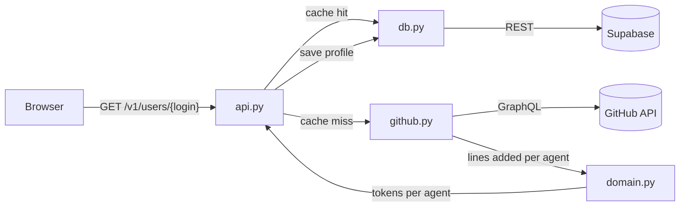

# GitToken


[GitFut](https://gitfut.com/) for token maxxers. Enter a GitHub username and get the LLM tokens that developer spent through coding agents, estimated from the agent commits in their public repos, plus the private repos they choose to connect.

## How it works today

One FastAPI service with the public routes under /v1. Profiles are cached in Supabase for a day.



1. Read the user's public, non-fork repos pushed to since 2025.
2. Keep the main-branch commits that have a coding agent among their authors or co-authors.
3. Tokens = lines added by those commits × 3,000 (a first guess).

Private repos are opt-in through a GitHub App. An account that installs it has the private, non-fork repos it owns and granted counted the same way, with a short-lived installation token that is revoked after each scan. Only each repo's numeric id and per-agent line counts are stored: no names, commit messages or code. GitHub's webhooks tell the API when access is taken back (app uninstalled or suspended, repo removed, deleted, transferred or made public), and those counts are dropped from the saved profile.

The same data is drawn as SVG cards from Jinja templates, for the site and for READMEs. Add `?theme=light` for the light variant (dark by default); the badges page at `/badges` gives a README snippet that follows the reader's GitHub theme.

| Route | What |
| --- | --- |
| `GET /v1/users/{login}` | Total and per-agent tokens, rarity, and the link that installs the GitHub App on that account |
| `GET /v1/badges/{login}/profile.svg` | Profile card with the GitHub avatar inlined |
| `GET /v1/badges/{login}.svg` | Card without the photo |
| `GET /v1/leaderboard` | Profiles scanned in the last day |
| `POST /v1/events/profile-search` | Sent by the site on each search; posts the login to Slack |
| `GET /v1/github-app/setup` | Where GitHub sends the browser after an install or a repository change; when the account's own user authorized the app, drops its cached profile so it is rescanned |
| `POST /v1/github-app/webhook` | GitHub's signed events; forgets private repos whose access was taken back |
| `GET /v1/agents`, `GET /v1/rarities` | The known agents and the rarity thresholds |

Each search submitted on the site posts its login to the Slack webhook in `SLACK_ACTIVITY_WEBHOOK_URL`, best effort within two seconds.

Profiles and cards are cached by the CDN for a day, matching the Supabase cache. GitHub's image proxy gives up after a few seconds, so a card whose first scan takes longer answers with a "Scanning" placeholder for a minute while the scan finishes. Badge errors (unknown user, GitHub down) are drawn as a card with status 200 and cached for ten minutes, so a README never shows a broken image.

```
make setup     # install everything, enable the pre-commit hook
FASTAPI_ENV=development GITHUB_TOKEN=$(gh auth token) uv run uvicorn gittoken.api:app   # API on :8000
make dev-web   # page on http://localhost:5173, proxies /v1 to the API
make check     # format, lint, typecheck: the same gate CI runs
make fix       # auto-format and auto-fix
```

Needs uv, pnpm and make.

Deployed on Vercel as one project: the FastAPI app also serves the built page. `vercel deploy --prod` from the repo root; the Vercel settings are under `[tool.vercel]` in `pyproject.toml`.

## Layout

| Path | What |
| --- | --- |
| `backend/src/gittoken/domain.py` | Agents, agent emails, the lines → tokens formula |
| `backend/src/gittoken/github.py` | GitHub scans, the GitHub App and its webhooks |
| `backend/src/gittoken/db.py` | Supabase profile cache |
| `backend/src/gittoken/application.py` | Use cases: lookup, GitHub App setup, consent withdrawal |
| `backend/src/gittoken/api.py` | FastAPI app and the `/v1` routes |
| `backend/src/gittoken/badge.py`, `templates/` | SVG cards: Jinja templates, palette, agent logos |
| `frontend/` | React site: search, profile card, badges, leaderboard |
| `supabase/`, `.github/` | Database migrations and CI |

## Rules

We start in the simplest shape that works and add structure when concrete code needs it. `AGENTS.md` (≤ 10 lines per directory) holds the rules humans and coding agents follow; `CLAUDE.md` imports it. [CONTRIBUTING.md](CONTRIBUTING.md) holds the PR workflow; [docs/CODING_RULES.md](docs/CODING_RULES.md) explains the coding rules in full.

## Next, each when it is needed

- **Better estimate**: calibrate the formula on real agent logs; show a range.
- **Scale**: several GitHub tokens, then a queue and workers if a profile is too slow to compute in one request.
- **Launch**: link previews showing the card.
